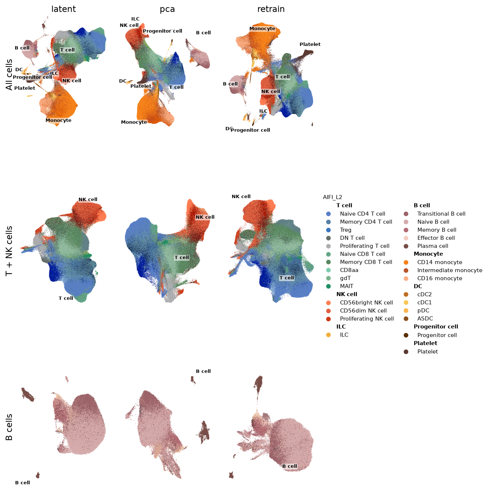
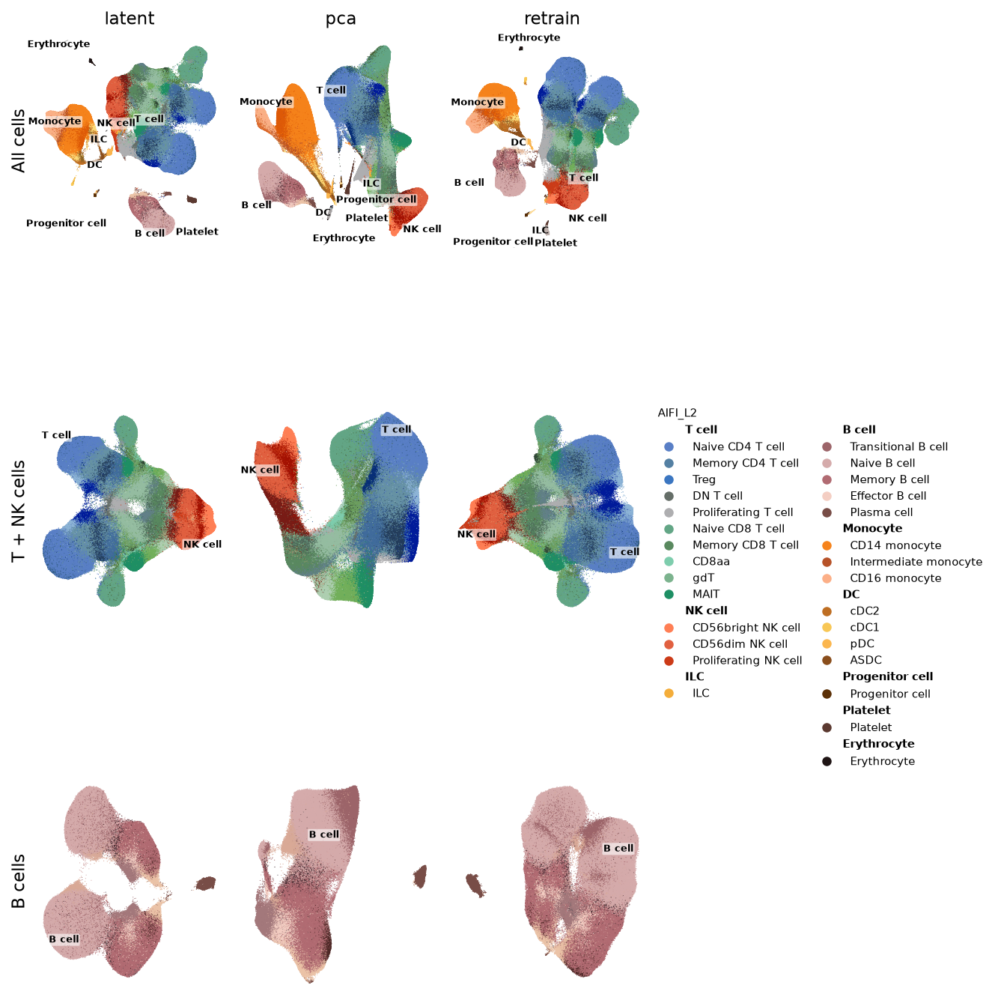
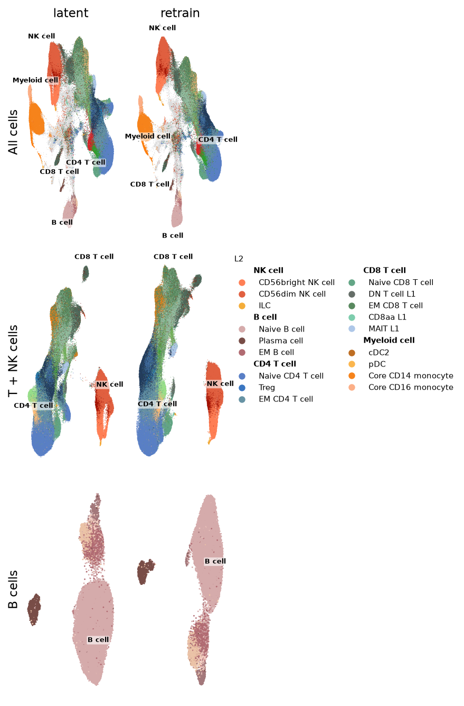
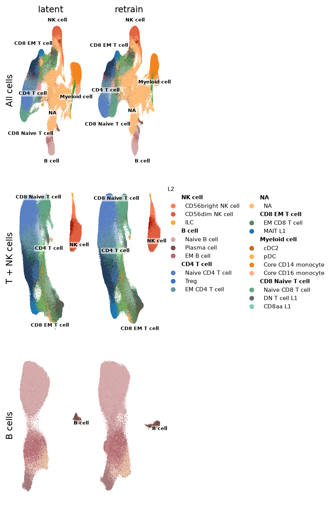

# Re-clustering a cell selection: scVI vs PCA (RNA), PeakVI vs LSI (ATAC)

When a datavis user selects cells, the app re-embeds just that selection and redraws its UMAP. This benchmark asks
whether a learned latent (scVI for RNA, PeakVI for ATAC) beats the current linear path (PCA + Harmony for RNA, LSI
for ATAC) on **runtime** and on **biology kept while batch effects are removed**.

This folder is a findings record, not a runnable pipeline. The pipeline code and environment were removed. What's left
is the parameters ([`config/`](config/)), the plotting code for reference ([`plotting/`](plotting/)), and the grid
UMAPs ([`umaps/`](umaps/)).

## Short answer

- **RNA:** keep **PCA + Harmony** as the default. It keeps as much biology as scVI or more and removes much more batch
  effect. A stored scVI latent is only worth adding as a **fast mode** for big selections: 1.2M B cells out of 13.8M
  take 8 s, versus 10 min for PCA. Retraining scVI per selection is not worth its cost.
- **ATAC:** **train PeakVI once per store and slice its latent.** It beats uncorrected LSI on cell-type purity at
  every selection and takes 1–18 s. Retraining per selection takes 2–14 min for little gain.
- **Stores:** sorting by cell type would cut PCA selection time on large stores. rna13m is unsorted, so a B-cell
  selection still reads nearly every chunk (10 min, versus 21 s on the sorted mmrna).

## What was run

| Dataset | Modality | Cells | Labels (coarse / fine) |
|---|---|---|---|
| mmrna | RNA | 2,374,117 | AIFI_L2 / AIFI_L3 |
| rna13m | RNA | 13,789,548 | AIFI_L2 / AIFI_L3 |
| mmatac | ATAC | 618,673 | L2 / L2.5 |
| covatac | ATAC | 2,718,917 | L2 / L2.5 |

The hardware was one A100 80 GB with 167 GB of host RAM, reading local zarr stores. Selections were picked by the L1
label the way a user would select in the app: `all`, `tnk` (T cell | NK cell) and `b` (B cell).

| Method | RNA | ATAC |
|---|---|---|
| `latent` | slice of a scVI latent trained once on the full dataset | slice of a PeakVI latent trained once on the full dataset |
| `pca` | normalize → log1p → HVG → scale → PCA → Harmony on `batch_id` | — |
| `retrain` | scVI trained from scratch on the selection | PeakVI trained from scratch on the selection |
| `unintegrated` | (reference) PCA without Harmony | (reference) TF-IDF + LSI, no batch correction |

Every method then runs the same tail: rapids-singlecell neighbors → UMAP, with no clustering. Each run was done twice in a
fresh process, and the numbers below are from rep 2.

### Key parameters ([`config/params.toml`](config/params.toml))

| Section | Setting |
|---|---|
| `[hvg]` | PCA: 2,000 `seurat` HVGs · scVI: 4,000 `seurat_v3` HVGs, batch-aware on `batch_id` |
| `[pca]` / `[harmony]` | 30 comps, `covariance_eigh` · Harmony on `batch_id`, alpha 1.0, theta 2.0 |
| `[scvi]` / `[peakvi]` | n_latent 30 (scVI, 2 layers, NB) / 40 (PeakVI, binarised peaks) · batch_size 1024 |
| `[epochs]` / `[train]` | `clamp(2e7 / n_cells, 10, 100)` epochs, no early stopping · KL warmed up over the first half |
| `[tail]` | k = 20 neighbors (ivfflat), UMAP min_dist 0.45, spectral init |

[`config/datasets.toml`](config/datasets.toml) maps each dataset to its store, label columns, batch/sample columns and
any stored latent.

## Runtime (read → UMAP)

| Dataset | Selection | Cells | Stored latent | PCA + Harmony | Retrain |
|---|---|---|---|---|---|
| mmrna | all | 2.37M | 22.6 s | 1.6 min | 5.3 min |
| | T + NK | 1.54M | 9.6 s | 1.3 min | 4.3 min |
| | B | 149k | 1.3 s | 21.1 s | 3.1 min |
| rna13m | all | 13.8M | 4.3 min | 15.5 min | 32.8 min |
| | T + NK | 9.85M | 1.6 min | 14.2 min | 24.2 min |
| | B | 1.21M | 7.9 s | 10.2 min | 9.0 min |
| mmatac | all | 619k | 3.7 s | — | 10.0 min |
| | T + NK | 413k | 2.6 s | — | 10.1 min |
| | B | 32k | 0.9 s | — | 1.7 min |
| covatac | all | 2.72M | 18.3 s | — | 14.2 min |
| | T + NK | 1.69M | 10.9 s | — | 11.1 min |
| | B | 151k | 1.3 s | — | 7.6 min |

Training the full-data model is a one-off cost: 5.2 min for mmrna, 30.5 min for rna13m, 9.9 min for mmatac and 13.9 min for covatac.

## Quality

The scores come from scib-metrics on coarse labels, written as **bio conservation / batch correction**, where higher is
better for both. All methods within a selection were scored on the same cells, using every labelled cell or a
sample-stratified sample of 500k.

| Dataset | Method | all | T + NK | B |
|---|---|---|---|---|
| mmrna | scVI latent | .58 / .44 | .56 / .54 | .55 / .49 |
| | PCA + Harmony | **.60 / .61** | **.56 / .59** | **.59 / .56** |
| | scVI retrain | .58 / .44 | .55 / .53 | .49 / .53 |
| rna13m | scVI latent | .61 / .51 | .57 / .49 | .54 / .46 |
| | PCA + Harmony | **.68 / .62** | **.64 / .65** | **.60 / .68** |
| | scVI retrain | .60 / .51 | .54 / .48 | .52 / .48 |
| mmatac | PeakVI latent | .66 / .45 | .62 / .44 | .61 / .43 |
| | PeakVI retrain | .65 / .45 | .63 / .46 | .59 / .64 |
| | LSI (uncorrected) | .64 / .43 | .62 / .43 | .75 / .41 |
| covatac | PeakVI latent | .66 / .52 | .64 / .53 | .70 / .52 |
| | PeakVI retrain | .65 / .53 | .66 / .54 | .67 / .57 |
| | LSI (uncorrected) | .63 / .52 | .58 / .52 | .60 / .53 |

- **RNA:** PCA + Harmony leads on both axes in every selection, and the pattern holds on fine labels. Local kNN
  cell-type purity is split: scVI is ahead on mmrna (0.69 vs 0.63 on all cells), and PCA is ahead inside rna13m's
  selections (B cells 0.86 vs 0.81).
- **ATAC:** PeakVI's kNN cell-type purity is +0.03–0.12 over LSI (up to +0.15 on fine types), and its graph
  connectivity is higher. Retraining only helps batch removal on the small mmatac B-cell selection.
- **Caveats:** scib's PCR comparison is 0 for most ATAC runs, so it tells us nothing there. The ATAC labels likely
  came from an LSI-style clustering, which flatters LSI on KMeans ARI/NMI. That explains its .75 bio score on mmatac B
  cells.

## UMAPs

The **cell-type grids** have one row per selection (all / T + NK / B) and one column per method. Each cell is coloured by
its finest label, the legend is grouped by coarse label, and L1 names are placed on the clusters.

| mmrna | rna13m |
|---|---|
|  |  |

| mmatac | covatac |
|---|---|
|  |  |

The **batch grids** use the same layout, coloured by a technical or donor column. Well-mixed colours mean the batch
effect was removed, and colour islands mean some remains. `sample` is `subject.subjectGuid` for RNA and `Sample` for ATAC.

| Dataset | batch_id | sample | pool_id | well_id |
|---|---|---|---|---|
| mmrna | [png](umaps/mmrna/batch_id.png) | [png](umaps/mmrna/sample.png) | [png](umaps/mmrna/pool_id.png) | [png](umaps/mmrna/well_id.png) |
| rna13m | [png](umaps/rna13m/batch_id.png) | [png](umaps/rna13m/sample.png) | [png](umaps/rna13m/pool_id.png) | [png](umaps/rna13m/well_id.png) |
| mmatac | [png](umaps/mmatac/batch_id.png) | [png](umaps/mmatac/sample.png) | [png](umaps/mmatac/pool_id.png) | [png](umaps/mmatac/well_id.png) |
| covatac | [png](umaps/covatac/batch_id.png) | [png](umaps/covatac/sample.png) | [png](umaps/covatac/pool_id.png) | [png](umaps/covatac/well_id.png) |

`plotting/30_plots.py` with `plotting/grids.py` and `batch_umaps.py` rendered these from each run's saved UMAP
coordinates. They're kept for reference only and won't run here, because they import the removed `scvi_pca` package.
